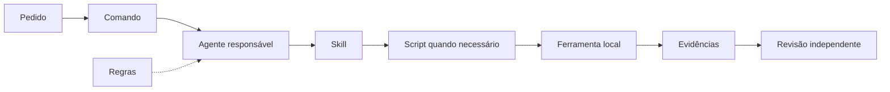

# Shared resources

[Português (Brasil)][reading-pt] · [English][reading-en] · [Español][reading-es]

[Documentation](../README.md) · [Flow](workflow.md) · [Tools and
tests](tools-and-testing.md)

Edit source at `.pbai4devs`. Client folders contain discovery references and
metadata; editing a generated copy creates divergence. The catalog
`.pbai4devs/catalog.json` allows you to find features by type. The hub remains
complete even with few selected clients. Only necessary notes are generated; see
or change the selection with `agents` ed [CLI](cli.md)Shared folders can serve
more than one client.

For an example of each type applied to software development, see [resources in
practice](recursos-na-pratica.md).

## Choose the right type

The paths below are related to `.pbai4devs/`.

| Type | Liability | Source |
| --- | --- | --- |
| Skill | Procedure and decisions. | `skills/<grupo>/<nome>/SKILL.md` |
| Rule | Convention applied to a context. | `rules/<nome>/RULE.md` |
| Command | Entry of a use case. | `commands/<nome>/COMMAND.md` |
| Officer | Responsible for a task. | `agents/<nome>/AGENT.md` |
| Template | Base to fill. | `templates/<nome>/TEMPLATE.md` |
| Tool | Configuration and input of a CLI. | `tools/<nome>/TOOL.json` |
| Script | Reusable executable automation. | `scripts/<nome>/SCRIPT.mjs` |

A skill explains how to decide; a script executes the operation. A command
forwards to these sources without repeating its instructions. A rule maintains a
recurring convention; an agent defines who reviews or executes a particular
role.

A skill can guide the use of other skills, commands, and agents. Those who make
these calls are the AI client, within the available tools and permissions. A
workflow is the sequence of steps and deliveries described in the command; it
does not need to be another type of file or a background schedule.



The main agent gathers results and maintains the context. When a client does not
allow nested delegation, the expert returns the next step to the main one.
Markdown and links do not create processes or execute code alone.

## Experts and collaboration

| Profile | When it contributes |
| --- | --- |
| [Architect][architect] | Borders, alternatives, risks and technical decisions. |
| [Backend][backend] | Contracts, data, integrations and server failures. |
| [Frontend][frontend] | Interaction, accessibility, states and real experience. |
| [QA][qa] e [validator][validator] | Cases, criteria and evidence executed. |
| [Safety auditor][auditor] | Threats and controls in the context of change. |
| [Performance][performance] | Load, metrics and comparison with defined goals. |
| [Reviewer][reviewer] | Independent review of change and evidence. |

Use only the profiles relevant to the task and project phase. When the client
allows, distribute independent tasks among subagents with unique writing files,
explicit dependencies and expected evidence. The main one integrates the
results. Without delegation, run sequentially and report what has not been
independently reviewed; links do not guarantee automatic execution.

## Create or evolve

Start with [create-resource][recurso] to locate an existing stream. Use the
specific creator when you know the type:

- [create-skill][skill]: reusable procedure.
- [create-rule][regra]: Convention with defined context and activation.
- [create-command][comando]: case of use and referral.
- [create-agent][agente]: specialized profile, such as reading review.

```text
Use criar-skill para orientar a revisão de contratos de API.
Confira se há algo equivalente, reúna dúvidas e proponha uma fonte concisa.
Reutilize scripts e ferramentas existentes; não copie instruções nos clientes.
```

Set purpose, input, output, prerequisites and what proves completion. Specify
who gets the output and in what situation. A command can reuse multiple skills
and a profile can contribute in different streams. Tools use your `SCRIPT.mjs`
to delegate to the common installer. Gather questions before making decisions.
Optional details can be found in nearby references; the main file should remain
easy to find.

## Metadata and formats

Markdown uses frontmatter YAML and a H1. Skills need `name` e `description`.
Rules define `trigger`: `always_on`, `model_decision`, `glob` or `manual`;
`glob` requires `globs`, and model decision requires useful description.

Customer-specific metadata stay in YAML next to the source, as
`agents/revisor/claude.yaml`. The manifest records its application. To evolve
AgentDevKit adapters, edit `templates/clients/ADAPTERS.json` no hub.
[compatibility][compatibilidade] before you promise to find out.

The grouping varies according to the format actually supported by the client. A
correct reference does not prove that the application loaded it automatically.
Do not use symlinks to replace Markdown notes.

## Synchronize and check

After changing a font, use the [CLI](cli.md) at the root of the installed
project:

```sh
npx @pathbit/agentdevkit sync --dry-run --json
npx @pathbit/agentdevkit sync
npx @pathbit/agentdevkit sync --check
node .pbai4devs/scripts/verificar-recursos/SCRIPT.mjs
```

Use the same package, version, and installation log. Review the plan before
applying. CLI recalculates the manifesto, including if a YAML native has been
created or changed. [direct
script](../kit/scripts/sincronizar-agentes/README.md) reuses the
existing manifesto. Claude rules `manual` e `model_decision` they are at the
origin for explicit reading. `glob`, configure `claude.yaml` with `paths`
explicit; it is not assumed that another client's globe is equivalent. When
disselecting Claude, old rules are preserved: `doctor` and the two checks warn
that they may still be active. The revision of unknown files remains necessary,
including with `--force`. An example with possible link to source can generate
conservative warning: detection does not interpret all Markdown constructions or
assigns property to the file. The installed manifest respects the chosen
clients. Do not replace it with a list of all to repair resources; change
selection by CLI if necessary. If there is conflict, check the property, scope
and preserved files. `--force` asks for repair only for eligible managed paths.
See
[conflicts and backups](troubleshooting.md#conflicts-and-backups) before applying.

Human native resources are preserved, including with `--force` and names like
the ones in the kit. Human links are treated as opaque paths; the generator does
not cross them. JSON, `preserved` lists human paths found in planning or
collisions; would not invent unexamined routes, such as an unused fallback. The
absence of a path does not prove that it was verified or preserved.

Do not edit or edit `catalog.json`, `skills.json`, `rules.json` or
`agents.json`: are local derivatives. Native settings and project documents
should not be replaced by copies of these indexes. In an existing installation,
`verificar-recursos` confers the hub and the registered leads, without requiring
frontmatter in the human documents of the project.

## What remains outside the mirrors

Only the four agentic types have notes: skills, rules, commands and agents.
Models, scripts, tools, tests, state and guides stay at the source. [external
skills][externas] remain local and ignored.

The test code and the necessary fixtures are versionable fonts. Results are not
sources. [ignore templates][ignore] and check with Git that the change did not
hide necessary files or included artifacts. README concise when creating a
first-level folder in the hub.

**[ Next step ]** Choose the creator, edit the font and use sync/check. For real
proofs, see [tools and tests](tools-and-testing.md).

[recurso]: ../kit/skills/projeto/criar-recurso/SKILL.md
[skill]: ../kit/skills/projeto/criar-skill/SKILL.md
[regra]: ../kit/skills/projeto/criar-regra/SKILL.md
[comando]: ../kit/skills/projeto/criar-comando/SKILL.md
[agente]: ../kit/skills/projeto/criar-agente/SKILL.md
[compatibilidade]: ../kit/COMPATIBILIDADE.md
[externas]: ../kit/external-skills/README.md
[ignore]: ../kit/templates/gitignore/TEMPLATE.md
[architect]: ../kit/agents/arquiteto/AGENT.md
[backend]: ../kit/agents/especialista-backend/AGENT.md
[frontend]: ../kit/agents/especialista-frontend/AGENT.md
[qa]: ../kit/agents/engenheiro-qa/AGENT.md
[validator]: ../kit/agents/validador/AGENT.md
[auditor]: ../kit/agents/auditor-seguranca/AGENT.md
[performance]: ../kit/agents/analista-performance/AGENT.md
[reviewer]: ../kit/agents/revisor/AGENT.md

[reading-pt]: ../../guides/resources.md
[reading-en]: resources.md
[reading-es]: ../../es/guides/resources.md
