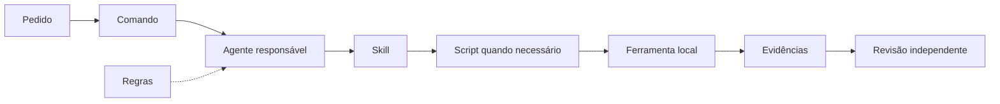

# Recursos compartidos

[Português (Brasil)][reading-pt] · [English][reading-en] · [Español][reading-es]

[Documentación](../README.md) · [Flujo](workflow.md) · [Herramientas y
pruebas](tools-and-testing.md)

Edite el origen en `.pbai4devs`. Las carpetas de los clientes contienen
referencias y metadatos de descubrimiento; editar una copia generada crea
divergencia. El catálogo `.pbai4devs/catalog.json` permite encontrar recursos
por tipo. El hub permanece completo incluso con pocos clientes seleccionados.
Sólo los apuntamientos necesarios son generados; consulte o modifique la
selección con `agents` la [CLI](cli.md). Carpetas compartidas pueden atender a
más de un cliente.

Para un ejemplo de cada tipo aplicado al desarrollo de software, vea [recursos
en la práctica](recursos-na-pratica.md).

## Elegir el tipo correcto

Los caminos abajo son relativos a `.pbai4devs/`.

| Tipo | Responsabilidad | Fuente |
| --- | --- | --- |
| Skill | Procedimiento y decisiones. | `skills/<grupo>/<nome>/SKILL.md` |
| Regla | Convenio aplicado a un contexto. | `rules/<nome>/RULE.md` |
| Orden | Entrada de un caso de uso. | `commands/<nome>/COMMAND.md` |
| Agente | Responsable por una tarea. | `agents/<nome>/AGENT.md` |
| Modelo | Base a rellenar. | `templates/<nome>/TEMPLATE.md` |
| Tools | Preferencias y entrada de una CLI. | `tools/<nome>/TOOL.json` |
| Script | Automación ejecutable reutilizable. | `scripts/<nome>/SCRIPT.mjs` |

Una skill explica cómo decidir; un script ejecuta la operación. Una orden
encamina a esas fuentes, sin repetir sus instrucciones. Una regla mantiene un
convenio recurrente; un agente define quién revisa o ejecuta un papel
determinado.

Una skill puede orientar el uso de otras skills, órdenes y agentes. Quien hace
estas llamadas es el cliente de IA, dentro de las herramientas y permisos
disponibles. Un workflow es la secuencia de pasos y entregas descrita en la
orden; no necesita ser otro tipo de archivo o un programa en segundo plano.



El agente principal reúne resultados y mantiene el contexto. Cuando un cliente
no permite delegación aninhada, el experto devuelve el siguiente paso al
principal. Markdown y enlaces no crean procesos ni ejecutan código solos.

## Expertos y colaboración

| Perfil | Cuando contribuye |
| --- | --- |
| [Architeto][architect] | Fronteras, alternativas, riesgos y decisiones técnicas. |
| [Backend][backend] | Contratos, datos, integraciones y fallos del servidor. |
| [Frontend][frontend] | Interacción, accesibilidad, estados y experiencia real. |
| [QA][qa] e [validador][validator] | Casos, criterios y evidencias ejecutadas. |
| [Interventor de seguridad][auditor] | Amenazas y controles en el contexto del cambio. |
| [Rendimiento][performance] | Carga, métricas y comparación con objetivos definidos. |
| [Revisor][reviewer] | Revisión independiente del cambio y de las pruebas. |

Utilice sólo los perfiles relevantes a la tarea y a la fase del proyecto. Cuando
el cliente permita, distribuya tareas independientes entre subagentes con
archivos de escritura exclusivos, dependencias explícitas y evidencias
esperadas. El principal integra los resultados. Sin delegación, ejecute
secuencialmente e informe lo que no tuvo revisión independiente; enlaces no
garantizan ejecución automática.

## Crear o evolucionar

Empecemos por [crear curso][recurso] Para localizar un flujo ya existente.
Utilice el creador específico cuando sepa el tipo:

- [crear-skill][skill]: procedimiento reutilizable.
- [crear-regra][regra]: convenio con contexto y activación definidos.
- [crear comando][comando]: caso de uso y encaminamiento.
- [crear agente][agente]: perfil especializado, como revisión en lectura.

```text
Use criar-skill para orientar a revisão de contratos de API.
Confira se há algo equivalente, reúna dúvidas e proponha uma fonte concisa.
Reutilize scripts e ferramentas existentes; não copie instruções nos clientes.
```

Establezca finalidad, entrada, salida, prerrequisitos y lo que comprueba la
conclusión. Introduzca quién recibe la salida y en qué situación. Una orden
puede reutilizar varias skills y un perfil puede contribuir a flujos diferentes.
Herramientas usan su `SCRIPT.mjs` Para delegar al instalador común. Reúna dudas
antes de tomar decisiones. Detalles opcionales pueden permanecer en referencias
cercanas; el archivo principal debe continuar fácil de encontrar.

## Metadados y formatos

Markdown usa frontmatter YAML y un H1. Skills necesitan `name` e `description`.
Reglas definen `trigger`: `always_on`, `model_decision`, `glob` o `manual`;
`glob` exige `globs`, y decisión del modelo exige una descripción útil.

Los metadatos específicos de un cliente se quedan en YAML al lado de la fuente,
como `agents/revisor/claude.yaml`. El manifiesto registra su aplicación. Para
evolucionar los adaptadores del AgentDevKit, edite
`templates/clients/ADAPTERS.json` No hub. Consulte a
[compatibilidad][compatibilidade] Antes de prometer el descubrimiento.

La agrupación varía según el formato realmente soportado por el cliente. Una
referencia correcta no prueba que la aplicación la cargó automáticamente. No use
symlinks para reemplazar los apuntamientos Markdown.

## Sincronizar y conferir

Después de cambiar una fuente, use la [CLI](cli.md) la raíz del proyecto
instalado:

```sh
npx @pathbit/agentdevkit sync --dry-run --json
npx @pathbit/agentdevkit sync
npx @pathbit/agentdevkit sync --check
node .pbai4devs/scripts/verificar-recursos/SCRIPT.mjs
```

Utilice el mismo paquete, versión y registro de la instalación. Revise el plan
antes de aplicar. A CLI recalcula el manifiesto, incluso si uno YAML nativo fue
creado o modificado. O [script
directo](../kit/scripts/sincronizar-agentes/README.md) reutiliza el
manifiesto existente. Reglas Claude `manual` e `model_decision` se encuentran en
el origen para lectura explícita. Para `glob`, configure `claude.yaml` com
`paths` explícitos; no se presume que glob de otro cliente sea equivalente. Al
desmarcar Claude, las reglas antiguas se conservan: `doctor` y los dos checks
advierten que todavía pueden estar activas. La revisión de archivos desconocidos
sigue siendo necesaria, incluso con `--force`. Un ejemplo con posible enlace al
origen puede generar aviso conservador: la detección no interpreta todas las
construcciones Markdown ni atribuye propiedad al archivo. El manifiesto
instalado respeta a los clientes elegidos. No lo sustituya por una lista de
todos para reparar recursos; cambia la selección por la CLI Si es necesario. Si
hay conflicto, comprueba la propiedad, el alcance y los archivos preservados.
`--force` pide reparación solamente para caminos administrativos elegibles. Vea
[conflictos y copias de
seguridad](troubleshooting.md#conflictos-y-copias-de-seguridad) antes
de aplicarlo.

Los recursos nativos humanos son preservados, incluso con `--force` y nombres
iguales a los del kit. Links humanos son tratados como caminos opacos; el
generador no los atraviesa. No JSON, `preserved` Lista caminos humanos
encontrados en la planificación o en colisiones; no inventaría rutas no
examinadas, como un fallback no utilizado. La ausencia de un camino no prueba
que fue verificado o preservado.

No edite o versione `catalog.json`, `skills.json`, `rules.json` o `agents.json`:
son derivados locales. Configuración nativa y documentos del proyecto no deben
ser sustituidos por copias de esos índices. En una instalación existente,
`verificar-recursos` confiere el hub y las derivaciones registradas, sin exigir
frontmatter en los documentos humanos del proyecto.

## Lo que permanece fuera de los espejos

Solamente los cuatro tipos agênticos tienen apuntamientos: skills, reglas,
órdenes y agentes. Modelos, scripts, tools, test, estado y guías quedan en el
origen. Descargas de tools y [skills externos][externas] Siguen siendo lugares y
ignorados.

El código de pruebas y las fixtures necesarias son fuentes versionables.
Resultados no son fuentes. Consulte los [modelos de ignore][ignore] y vea con
Git que la alteración no ocultaba archivos necesarios o incluyó artefactos.
Mantenga un README conciso al crear una carpeta de primer nivel en el hub.

**[ Siguiente paso ]** Elija el creador, edite la fuente y use sync/check. Para
pruebas reales, consulte [herramientas y pruebas](tools-and-testing.md).

[recurso]: ../kit/skills/projeto/criar-recurso/SKILL.md
[skill]: ../kit/skills/projeto/criar-skill/SKILL.md
[regra]: ../kit/skills/projeto/criar-regra/SKILL.md
[comando]: ../kit/skills/projeto/criar-comando/SKILL.md
[agente]: ../kit/skills/projeto/criar-agente/SKILL.md
[compatibilidade]: ../kit/COMPATIBILIDADE.md
[externas]: ../kit/external-skills/README.md
[ignore]: ../kit/templates/gitignore/TEMPLATE.md
[architect]: ../kit/agents/arquiteto/AGENT.md
[backend]: ../kit/agents/especialista-backend/AGENT.md
[frontend]: ../kit/agents/especialista-frontend/AGENT.md
[qa]: ../kit/agents/engenheiro-qa/AGENT.md
[validator]: ../kit/agents/validador/AGENT.md
[auditor]: ../kit/agents/auditor-seguranca/AGENT.md
[performance]: ../kit/agents/analista-performance/AGENT.md
[reviewer]: ../kit/agents/revisor/AGENT.md

[reading-pt]: ../../guides/resources.md
[reading-en]: ../../en/guides/resources.md
[reading-es]: resources.md
