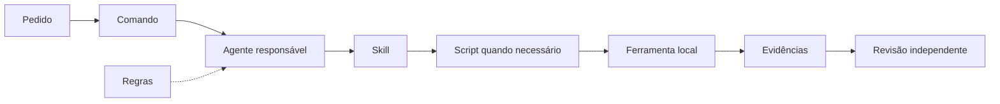

# Recursos compartilhados

[Documentação](../README.md) · [Fluxo](workflow.md) ·
[Ferramentas e testes](tools-and-testing.md)

Edite a origem em `.pbai4devs`. As pastas dos clientes contêm referências e
metadados de descoberta; editar uma cópia gerada cria divergência.
O catálogo `.pbai4devs/catalog.json` permite encontrar recursos por tipo.
O hub permanece completo mesmo com poucos clientes selecionados. Apenas os
apontamentos necessários são gerados; consulte ou altere a seleção com `agents`
na [CLI](cli.md). Pastas compartilhadas podem atender mais de um cliente.

Para um exemplo de cada tipo aplicado ao desenvolvimento de software, veja
[recursos na prática](recursos-na-pratica.md).

## Escolher o tipo certo

Os caminhos abaixo são relativos a `.pbai4devs/`.

| Tipo | Responsabilidade | Fonte |
| --- | --- | --- |
| Skill | Procedimento e decisões. | `skills/<grupo>/<nome>/SKILL.md` |
| Regra | Convenção aplicada a um contexto. | `rules/<nome>/RULE.md` |
| Comando | Entrada de um caso de uso. | `commands/<nome>/COMMAND.md` |
| Agente | Responsável por uma tarefa. | `agents/<nome>/AGENT.md` |
| Modelo | Base a preencher. | `templates/<nome>/TEMPLATE.md` |
| Tool | Configuração e entrada de uma CLI. | `tools/<nome>/TOOL.json` |
| Script | Automação executável reutilizável. | `scripts/<nome>/SCRIPT.mjs` |

Uma skill explica como decidir; um script executa a operação. Um comando
encaminha a essas fontes, sem repetir suas instruções. Uma regra mantém uma
convenção recorrente; um agente define quem revisa ou executa determinado papel.

Uma skill pode orientar o uso de outras skills, comandos e agentes. Quem faz
essas chamadas é o cliente de IA, dentro das ferramentas e permissões disponíveis.
Um workflow é a sequência de passos e entregas descrita no comando; não precisa
ser outro tipo de arquivo ou um agendamento em segundo plano.



O agente principal reúne resultados e mantém o contexto. Quando um cliente
não permite delegação aninhada, o especialista devolve o próximo passo ao
principal. Markdown e links não criam processos nem executam código sozinhos.

## Especialistas e colaboração

| Perfil | Quando contribui |
| --- | --- |
| [Arquiteto][architect] | Fronteiras, alternativas, riscos e decisões técnicas. |
| [Backend][backend] | Contratos, dados, integrações e falhas do servidor. |
| [Frontend][frontend] | Interação, acessibilidade, estados e experiência real. |
| [QA][qa] e [validador][validator] | Casos, critérios e evidências executadas. |
| [Auditor de segurança][auditor] | Ameaças e controles no contexto da mudança. |
| [Performance][performance] | Carga, métricas e comparação com metas definidas. |
| [Revisor][reviewer] | Revisão independente da mudança e das provas. |

Use apenas os perfis relevantes à tarefa e à fase do projeto. Quando o cliente
permitir, distribua tarefas independentes entre subagentes com arquivos de
escrita exclusivos, dependências explícitas e evidências esperadas. O principal
integra os resultados. Sem delegação, execute sequencialmente e informe o que
não teve revisão independente; links não garantem execução automática.

## Criar ou evoluir

Comece por [criar-recurso][recurso] para localizar um fluxo já existente.
Use o criador específico quando souber o tipo:

- [criar-skill][skill]: procedimento reutilizável.
- [criar-regra][regra]: convenção com contexto e ativação definidos.
- [criar-comando][comando]: caso de uso e encaminhamento.
- [criar-agente][agente]: perfil especializado, como revisão em leitura.

```text
Use criar-skill para orientar a revisão de contratos de API.
Confira se há algo equivalente, reúna dúvidas e proponha uma fonte concisa.
Reutilize scripts e ferramentas existentes; não copie instruções nos clientes.
```

Defina finalidade, entrada, saída, pré-requisitos e o que comprova a conclusão.
Indique quem recebe a saída e em qual situação. Um comando pode reutilizar
várias skills e um perfil pode contribuir em fluxos diferentes. Ferramentas
usam seu `SCRIPT.mjs` para delegar ao instalador comum.
Reúna dúvidas antes de tomar decisões. Detalhes opcionais podem ficar em
referências próximas; o arquivo principal deve continuar fácil de encontrar.

## Metadados e formatos

Markdown usa frontmatter YAML e um H1. Skills precisam de `name` e
`description`. Regras definem `trigger`: `always_on`, `model_decision`, `glob`
ou `manual`; `glob` exige `globs`, e decisão do modelo exige descrição útil.

Metadados específicos de um cliente ficam em YAML ao lado da fonte, como
`agents/revisor/claude.yaml`. O manifesto registra sua aplicação. Para evoluir
os adaptadores do AgentDevKit, edite `templates/clients/ADAPTERS.json` no hub.
Consulte a [compatibilidade][compatibilidade] antes de prometer descoberta.

O agrupamento varia conforme o formato realmente suportado pelo cliente.
Uma referência correta não prova que o aplicativo a carregou automaticamente.
Não use symlinks para substituir os apontamentos Markdown.

## Sincronizar e conferir

Após alterar uma fonte, use a [CLI](cli.md) na raiz do projeto instalado:

```sh
npx @pathbit/agentdevkit sync --dry-run --json
npx @pathbit/agentdevkit sync
npx @pathbit/agentdevkit sync --check
node .pbai4devs/scripts/verificar-recursos/SCRIPT.mjs
```

Use o mesmo pacote, versão e registro da instalação. Revise o plano antes de
aplicar. A CLI recalcula o manifesto, inclusive se
um YAML nativo foi criado ou alterado. O
[script direto](../../.pbai4devs/scripts/sincronizar-agentes/README.md)
reutiliza o manifesto existente.
Regras Claude `manual` e `model_decision` ficam na origem para leitura explícita.
Para `glob`, configure `claude.yaml` com `paths` explícitos; não se presume
que glob de outro cliente seja equivalente. Ao desmarcar Claude, regras antigas
são preservadas: `doctor` e os dois checks avisam que ainda podem estar ativas.
A revisão de arquivos desconhecidos continua necessária, inclusive com `--force`.
Um exemplo com possível link à origem pode gerar aviso conservador: a detecção
não interpreta todas as construções Markdown nem atribui propriedade ao arquivo.
O manifesto instalado respeita os clientes escolhidos. Não o substitua por uma
lista de todos para reparar recursos; altere a seleção pela CLI se necessário.
Se houver conflito, confira a propriedade, o escopo e os arquivos preservados.
`--force` pede reparo somente para caminhos gerenciados elegíveis. Veja
[conflitos e backups](troubleshooting.md#conflitos-e-backups) antes de aplicar.

Recursos nativos humanos são preservados, inclusive com `--force` e nomes
iguais aos do kit. Links humanos são tratados como caminhos opacos; o gerador
não os atravessa. No JSON, `preserved` lista caminhos humanos encontrados no
planejamento ou em colisões; não inventaria rotas não examinadas, como um
fallback não utilizado. A ausência de um caminho não prova que ele foi
verificado ou preservado.

Não edite ou versione `catalog.json`, `skills.json`, `rules.json` ou
`agents.json`: são derivados locais. Configurações nativas e documentos
do projeto não devem ser substituídos por cópias desses índices.
Em uma instalação existente, `verificar-recursos` confere o hub e as derivações
registradas, sem exigir frontmatter nos documentos humanos do projeto.

## O que permanece fora dos espelhos

Somente os quatro tipos agênticos têm apontamentos: skills, regras, comandos
e agentes. Modelos, scripts, tools, testes, estado e guias ficam na origem.
Downloads de tools e [skills externas][externas] permanecem locais e ignorados.

O código de testes e as fixtures necessárias são fontes versionáveis.
Resultados não são fontes. Consulte os [modelos de ignore][ignore] e confira
com Git que a alteração não ocultou arquivos necessários ou incluiu artefatos.
Mantenha um README conciso ao criar uma pasta de primeiro nível no hub.

**[ Próximo passo ]** Escolha o criador, edite a fonte e use sync/check.
Para provas reais, consulte [ferramentas e testes](tools-and-testing.md).

[recurso]: ../../.pbai4devs/skills/projeto/criar-recurso/SKILL.md
[skill]: ../../.pbai4devs/skills/projeto/criar-skill/SKILL.md
[regra]: ../../.pbai4devs/skills/projeto/criar-regra/SKILL.md
[comando]: ../../.pbai4devs/skills/projeto/criar-comando/SKILL.md
[agente]: ../../.pbai4devs/skills/projeto/criar-agente/SKILL.md
[compatibilidade]: ../../.pbai4devs/COMPATIBILIDADE.md
[externas]: ../../.pbai4devs/external-skills/README.md
[ignore]: ../../.pbai4devs/templates/gitignore/TEMPLATE.md
[architect]: ../../.pbai4devs/agents/arquiteto/AGENT.md
[backend]: ../../.pbai4devs/agents/especialista-backend/AGENT.md
[frontend]: ../../.pbai4devs/agents/especialista-frontend/AGENT.md
[qa]: ../../.pbai4devs/agents/engenheiro-qa/AGENT.md
[validator]: ../../.pbai4devs/agents/validador/AGENT.md
[auditor]: ../../.pbai4devs/agents/auditor-seguranca/AGENT.md
[performance]: ../../.pbai4devs/agents/analista-performance/AGENT.md
[reviewer]: ../../.pbai4devs/agents/revisor/AGENT.md
